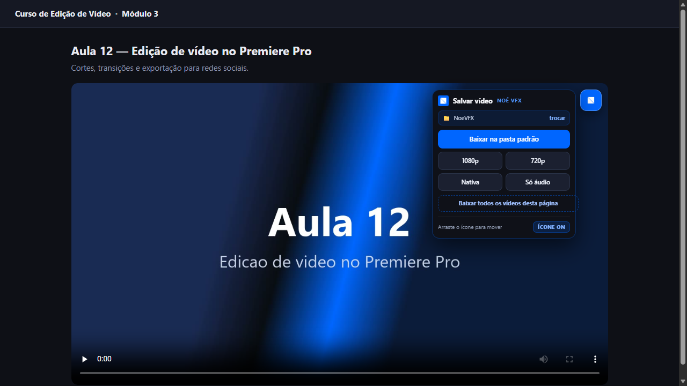
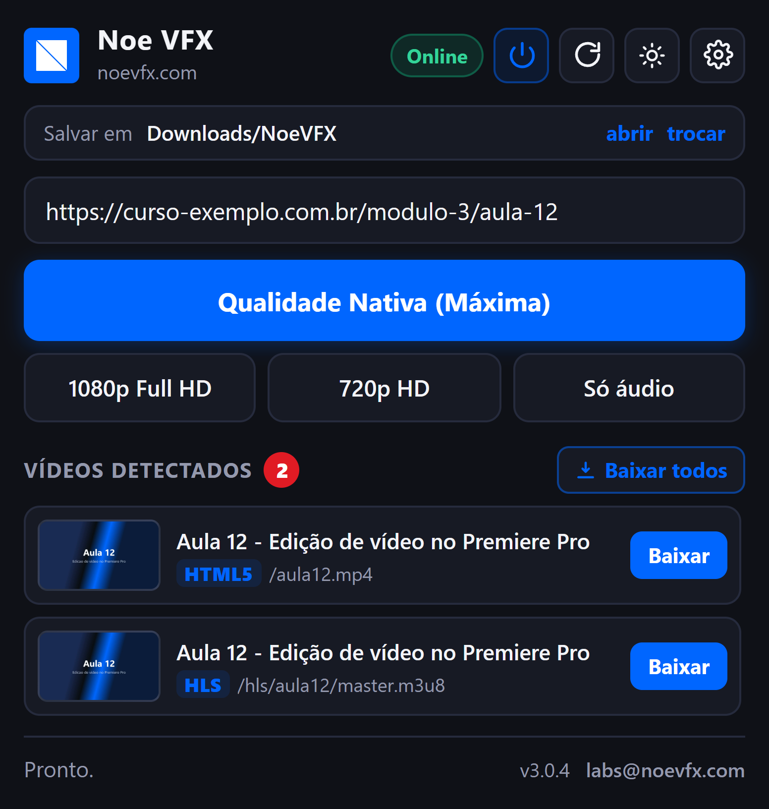
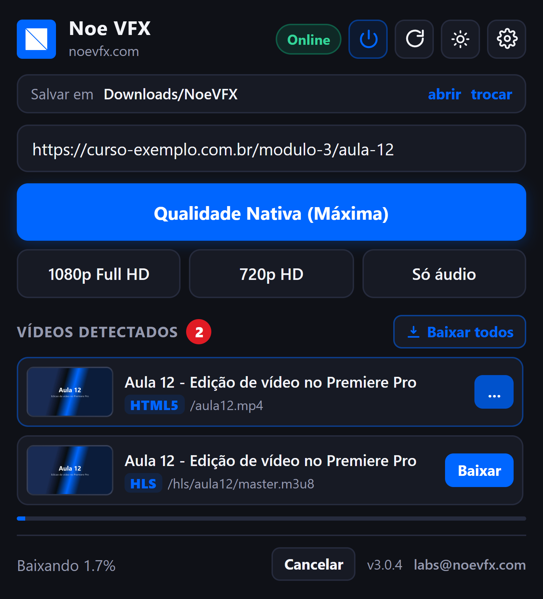

<p align="center">
  
</p>

<h1 align="center">Noe VFX Downloader</h1>

<p align="center">
  Salva para assistir offline os vídeos que você <b>já consegue assistir</b> na página,<br>
  na melhor qualidade que o player entrega, com a pasta e a qualidade que você escolher.
  <br><sub>NOÉ VFX · <a href="https://noevfx.com">noevfx.com</a> · <a href="mailto:labs@noevfx.com">labs@noevfx.com</a></sub>
</p>

<p align="center">
  
  
  
  
</p>

<p align="center">
  <a href="#baixar">Baixar</a> ·
  <a href="#plataformas-testadas">Plataformas</a> ·
  <a href="#o-que-ele-faz">O que faz</a> ·
  <a href="#instalação">Instalar</a> ·
  <a href="#atualizar">Atualizar</a> ·
  <a href="#problemas-comuns">Problemas</a> ·
  <a href="docs/MANUAL-DE-USO.md">Manual completo</a>
</p>

---

## O que é

Uma extensão para Chrome, Edge e outros navegadores Chromium, mais um **aplicativo local** (Python puro) que roda no seu
computador e usa o [yt-dlp](https://github.com/yt-dlp/yt-dlp) e o FFmpeg para baixar. A extensão descobre o vídeo da página
(até o que o site esconde atrás de `blob:` e de pedaços de streaming), mostra **um item por vídeo, com a miniatura e o nome certos**,
e o aplicativo salva o arquivo com **vídeo e áudio juntos** na pasta que você escolheu.

Feita para uso próprio e de amigos: **não está em nenhuma loja**; instala-se em modo desenvolvedor, com o instalador deste pacote.

---

## Baixar

**Pacote completo (extensão + aplicativo local + instaladores):**
[`noevfx-downloader-3.0.15.zip`](https://github.com/noevfx/Extensions/releases/download/v3.0.15/noevfx-downloader-3.0.15.zip)  <sub>(a versão está no nome do arquivo e no `VERSION.txt` dentro dele; o SHA-256 está nas notas de cada [release](https://github.com/noevfx/Extensions/releases))</sub>

| Sistema | Pasta no zip | Instalador |
|---|---|---|
| Windows 10/11 | `windows/` | `INSTALAR_NOEVFX.bat` |
| macOS (Intel e Apple Silicon) | `mac/` | `INSTALAR-MAC.command` (ou `instalar-noevfx.sh`) |
| Linux | `linux/` | `instalar-noevfx.sh` |

> A pasta extraída serve **somente para instalar**. O programa é copiado para uma pasta do sistema e roda de lá; depois você pode apagar o que extraiu.

---

## Plataformas testadas

Testadas com sites reais no Windows (Edge e Chrome), com o aplicativo local, o yt-dlp e o FFmpeg de verdade:

| Plataforma | O que funciona |
|---|---|
| **YouTube** | botão Baixar no player e item no popup, na melhor qualidade, com áudio |
| **Instagram** | posts e reels; **carrossel: baixa todos os vídeos** (as fotos são ignoradas); cada vídeo com a própria miniatura |
| **TikTok** | um item por vídeo, com miniatura e nome certos; a lista se atualiza ao rolar o feed |
| **X (Twitter)** | um item por tweet com vídeo (confirmado no feed real); baixa **todos os vídeos do tweet** |
| **Pinterest** | um item por pin, com o nome do pin; **pin com vários vídeos baixa todos**; vídeo do feed vira item com a própria miniatura e o ícone baixa (sem link de pin sai como `Vídeo do Pinterest [código]`) |
| **Vimeo** | vídeos públicos e embutidos em outras páginas |
| **G1 / Globoplay** | o vídeo da matéria (sem confundir com os "veja também"); transmissão ao vivo grava a partir do HLS |
| **Facebook** | vídeo público baixa pelo link do vídeo/Reel; **o feed ainda não está confirmado** (em ajuste) |
| **Sites comuns** | players com MP4, HLS (`.m3u8`) e DASH; players embutidos (iframe) de cursos |

**O que não baixa:** vídeo protegido por DRM (Netflix, Disney+ e vídeos Vimeo/Globo marcados como protegidos), conteúdo privado sem
login e transmissão ao vivo cancelada no meio (o parcial se perde). Para conteúdo que exige login, entre na sua conta no navegador e
deixe **Usar os cookies do navegador** ligado nas Configurações.

**Limites conhecidos:** o feed do Facebook (em ajuste); no Pinterest, o vídeo do feed sem link de pin é baixado pelo stream do player e sai com nome genérico
(abra o pin para ter o nome e o carrossel inteiro); macOS e Linux têm o instalador testado pela CI, mas o uso no
navegador foi validado só no Windows. Se algum item vier sem miniatura ou com o arquivo errado, mande o print e o link do post.

---

## O que ele faz

- **Encontra o vídeo que a página carrega**: HLS, DASH, MP4, WebM, `blob:` e players embutidos. Em sites conhecidos (Instagram, TikTok, X,
  Facebook, Pinterest, Vimeo, G1) lista **o vídeo de verdade da publicação**, não os pedaços que o site baixa por trás.
- **Um item por vídeo**, com **miniatura própria** (um quadro do próprio vídeo) e nome do post; o vídeo que está tocando vem primeiro.
- **A lista se atualiza sozinha**: trocar de vídeo em site de página única (TikTok, Instagram, YouTube...) refaz a lista sem recarregar a aba.
- **Ícone no canto do vídeo**: um clique salva; arraste para mover (a posição fica salva por site); liga/desliga em 3 lugares.
- **Botão direito** no vídeo ou na página: baixar na qualidade nativa ou baixar todos.
- **Qualidade**: a melhor que o player oferece, 1080p, 720p ou só áudio (M4A).
- **Salvar um ou todos**, com **fila**, progresso, **cancelar** e aviso de vídeo já em download.
- **Pasta padrão** escolhida por você (perguntada no primeiro uso). Sem escolher, vai para a pasta **Vídeos** do seu usuário, em `NoeVFX` (no Mac, `Filmes`). Opção de **subpasta por site**.
- **Contador no ícone** da extensão: quantos vídeos existem na aba.
- **Cookies do seu próprio navegador** (opcional) para o que exige login. Não contorna login nem assinatura.
- **Atualização pelo próprio botão**: o app confere a última release no GitHub, valida o SHA-256 e troca os arquivos (veja [Atualizar](#atualizar)).
- **Idioma automático** (português ou inglês) e **tema claro/escuro**.

---

## Como funciona

```
┌──────────────────────────────┐        ┌──────────────────────────────┐
│  Extensão (Chromium, MV3)    │  HTTP  │  Aplicativo local (Python)   │
│  · lê a mídia da aba         │ ─────► │  127.0.0.1:8765              │
│  · acha o vídeo de cada post │        │  · yt-dlp  · ffmpeg          │
│  · ícone no vídeo, popup     │ ◄───── │  · fila · atualização        │
└──────────────────────────────┘        └──────────────────────────────┘
                                                  │
                                                  ▼
                                        pasta escolhida por você
```

1. A extensão observa as requisições da aba (`webRequest`) e a página (`<video>`, players embutidos, `blob:`), e, em sites conhecidos,
   descobre o **link da publicação** (post, tweet, pin, vídeo). Pedaços de streaming (segmentos, faixas de bytes, DRM) são descartados.
2. Ao salvar, a extensão manda ao aplicativo local o link da publicação (ou o do stream), o Referer e, se você permitiu, os cookies.
3. O aplicativo chama o **yt-dlp** (que junta vídeo e áudio com o FFmpeg) e grava o arquivo. Casos especiais:
   Instagram e X baixam todos os vídeos do post; Pinterest resolve o pin pela API pública do próprio site (carrossel incluso);
   Vimeo usa o player embutido; G1 ao vivo usa a playlist HLS principal.
4. O **yt-dlp se atualiza sozinho** (no máximo 1 vez por dia, com o app ligado), porque os sites mudam toda semana.

---

## Segurança e privacidade

- O aplicativo escuta **apenas `127.0.0.1`**, exige o cabeçalho `X-NoeVFX-Client` e só aceita **escritas** de extensões (`chrome-extension://`).
- **Zero telemetria**: nada seu é coletado nem enviado. A extensão fala só com o aplicativo local.
- Conexões do aplicativo além do site do vídeo: **GitHub**, para atualizar o yt-dlp e conferir a última versão do app (a consulta não leva
  dado pessoal), e a instalação baixa yt-dlp, FFmpeg, Deno e Python das fontes oficiais, com checagem de integridade.
- A atualização do app **só baixa de `github.com/noevfx/Extensions`**, **confere o SHA-256**, valida a versão dentro do pacote e guarda uma cópia
  da versão anterior; nunca atualiza a pasta de desenvolvimento.
- Cookies vão para um arquivo temporário, usado só pelo yt-dlp, e são apagados no fim.
- Permissões da extensão: `webRequest` e `<all_urls>` (ver a mídia da aba), `cookies` (conteúdo com login), `storage` e `contextMenus`.
  Exige Chrome/Edge 116 ou mais novo.
- Detalhes em [`PRIVACY.md`](PRIVACY.md) e [`TERMS.md`](TERMS.md).

> A ferramenta usa a sessão que **você** já tem aberta. Ela não cria acesso, não quebra login, não ignora assinatura e não remove DRM.

---

## Compatibilidade

| Tipo | Suporte |
|---|---|
| HLS (`.m3u8`), DASH (`.mpd`), MP4 / WebM diretos | sim |
| Players embutidos (YouTube, Vimeo, Dailymotion, Globo e outros de curso) | sim |
| Conteúdo atrás do seu próprio login | sim, usando a sua sessão |
| Transmissão ao vivo | grava (cancelar no meio perde o parcial) |
| Conteúdo protegido por DRM | **não** |
| Navegadores | Chrome, Edge, Brave, Opera, Vivaldi e outros Chromium 116+ |
| Sistemas | Windows 10/11, macOS (Intel e Apple Silicon), Linux |

---

## Como fica

<p align="center">
  
</p>

<table>
<tr>
<td width="50%"></td>
<td width="50%"></td>
</tr>
<tr>
<td align="center"><sub>Popup: tudo que a página carrega, com miniatura</sub></td>
<td align="center"><sub>Progresso e botão Cancelar</sub></td>
</tr>
</table>

📖 **[Manual de uso completo, com todas as telas](docs/MANUAL-DE-USO.md)**: instalar, configurar, baixar
(ícone no vídeo, popup, botão direito, YouTube), qualidades, cursos com login e o que fazer quando algo falha.

---

## Instalação

### Windows

O instalador faz tudo sozinho, **sem administrador e sem nada instalado antes**
(Python, yt-dlp com checagem SHA-256, FFmpeg e Deno para o YouTube; só baixa o que faltar).
Pode rodar de novo para reinstalar ou atualizar.

1. Baixe e **extraia** o zip
2. Abra `windows\INSTALAR_NOEVFX.bat`
   - copia tudo para `%LOCALAPPDATA%\NoeVFXDownloader`
   - cria o aplicativo oculto que inicia com o Windows
   - abre um **guia visual** no navegador com o último passo
3. No navegador: **Modo de desenvolvedor** → **arraste a pasta `extension`** (o Explorer abre com ela selecionada) para a página de extensões
   (ou **Carregar sem pacote** → cole o caminho copiado → entre na pasta → clique 1x em `extension` → **Selecionar pasta**)

### macOS / Linux

macOS: botão direito em `mac/INSTALAR-MAC.command` → **Abrir** (só na 1ª vez). Ou, em qualquer um dos dois:

```bash
cd mac        # ou: cd linux
bash instalar-noevfx.sh
```

Copia para `~/.local/share/NoeVFXDownloader` e cria o serviço de inicialização
(LaunchAgent no macOS, `systemd --user` no Linux). O log da instalação fica em `install.log`.
O instalador dos três sistemas é testado automaticamente a cada versão
(GitHub Actions: Windows, macOS Apple/Intel, Linux x64/ARM).

> **O erro mais comum:** carregar a extensão da pasta **extraída do zip**. O
> navegador guarda o caminho e a extensão quebra quando você apaga a pasta.
> Carregue sempre da pasta **instalada**.

### Desinstalar

Rode `DESINSTALAR_NOEVFX.bat` (Windows) ou `bash desinstalar-noevfx.sh` (macOS/Linux) e, no navegador, **Remova** a extensão.
Os vídeos baixados **não** são apagados.

---

## Primeiro uso

1. **Aplicativo local** → deve mostrar `online`, `yt-dlp ✓`, `FFmpeg ✓`
2. **Pasta padrão** → **Escolher pasta…**
3. **Ícone no vídeo** → *perguntar antes de salvar* ou *salvar direto*
4. **Qualidade padrão** → melhor disponível, 1080p, 720p ou só áudio
5. **Concluir configuração**

---

## Usando no dia a dia

| Ação | Como |
|---|---|
| Salvar um vídeo | Passe o mouse no vídeo → clique no ícone azul |
| Salvar pelo popup | Clique na extensão → **Baixar** no item (ou **Baixar todos**) |
| Ligar/desligar o ícone | Popup (botão de energia), botão direito ou rodapé do cartão |
| Mover o ícone | Arraste; a posição fica salva por site |
| Atualizar a detecção | Botão **⟳** no popup (`Shift`+clique recarrega a página) |
| Abrir a pasta | Popup → **abrir** |
| Ver a versão / checar atualização | Clique na versão no rodapé do popup |

---

## Atualizar

A extensão roda em modo desenvolvedor, então o navegador **não a atualiza sozinho**. Quem atualiza é o aplicativo local:

- **Pelo botão (a partir da 3.0.14):** ao abrir o popup, o app confere em silêncio a última release no GitHub (guarda a resposta por 10 minutos).
  Se houver versão nova, aparece uma faixa azul com **Atualizar agora**. Para checar na hora, clique na **versão no rodapé do popup** ou em
  **Verificar atualizações** nas Configurações. Ao confirmar, o app baixa o zip da release, **confere o SHA-256**, guarda uma cópia da versão atual
  em `_backups\v<versão>` (dentro da pasta instalada), troca os arquivos, reinicia o servidor e a extensão se recarrega sozinha.
  Não atualiza com download em andamento.
- **Pelo instalador (sempre funciona):** rode o instalador do zip novo e, em `chrome://extensions` (ou `edge://extensions`), clique em **Recarregar**.

Versões anteriores à 3.0.14 não têm o botão: a primeira atualização delas é pelo instalador do zip novo. Configurações, pasta escolhida e
posições salvas são preservadas.

---

## Problemas comuns

| Sintoma | Solução |
|---|---|
| Selo **Offline** | Rode o instalador novamente; o aplicativo sobe com o sistema |
| Nenhum vídeo detectado | Dê **play** e clique em **⟳** |
| Erro de FFmpeg / vídeo sem áudio | Rode o instalador (a união vídeo+áudio depende dele) |
| Vídeo só aparece logado | Ative **Usar os cookies do navegador** nas configurações e entre na sua conta |
| "Esse conteúdo exige login" (X, Facebook) | Entre na conta no navegador, com os cookies ligados, e tente de novo |
| "Esse vídeo tem proteção DRM" | Não baixa: a ferramenta não contorna DRM |
| Aviso "não achei o link deste post/tweet/pin" | Abra o post, tweet ou pin (clique nele ou na data) e baixe de lá |
| Extensão sumiu ou ficou cinza | Você apagou a pasta de onde carregou: carregue a pasta **instalada** |
| O botão de atualizar não acha nada, ou o popup mostra uma versão diferente da instalada | A extensão está carregada da pasta **extraída do zip** (ex.: `Desktop\windows\extension`). Em `edge://extensions` remova-a e carregue `%LOCALAPPDATA%\NoeVFXDownloader\extension` (no macOS/Linux, `~/.local/share/NoeVFXDownloader/extension`) |
| Erro 403 | O yt-dlp já se atualiza sozinho (1x por dia, com o app ligado). Se persistir, reinicie o computador para o app subir e atualizar, ou rode `yt-dlp -U` (ou o instalador) |
| Qualquer outra coisa | Configurações → **Copiar diagnóstico** e mande para quem te passou o app |

**Logs:** Windows `%LOCALAPPDATA%\NoeVFXDownloader\server.log` · Linux `~/.local/share/NoeVFXDownloader/server.log` ·
macOS `~/Library/Logs/NoeVFXDownloader.log`

**Suporte:** [labs@noevfx.com](mailto:labs@noevfx.com)

---

## Como foi testado

| Teste | O que cobre | Como rodar |
|---|---|---|
| `tests/test_server.py` | regras do servidor (34 testes): segurança, comandos do yt-dlp, Vimeo, Instagram/X/Pinterest, fragmentos e DRM, atualização | `python -m unittest tests.test_server` |
| `tests/e2e_sites.js` | extensão num navegador de verdade, com mouse e sites simulados em HTTPS (Instagram, X, Facebook, Pinterest, TikTok, G1, página com `blob:`, shadow DOM, botão de atualizar): 52 checagens | `node tests/e2e_sites.js` |
| `tests/popup_group.js` | agrupamento da lista do popup | `node tests/popup_group.js` |
| `tests/real_site.js <url>` | uma página real com a extensão, o servidor, o yt-dlp e o ffprobe | `node tests/real_site.js <url> [segundos]` |
| `tests/dl_url.js <url>` | baixar um link pelo servidor e conferir o arquivo | `node tests/dl_url.js <url>` |
| `tests/install_smoke.py` | instalação real | usado pela CI |

A CI (`.github/workflows/test.yml`) testa o instalador em Windows, macOS e Linux a cada versão. O teste antigo `tests/e2e.js` ainda roda lá e
falha no GitHub por não conseguir carregar a extensão no navegador da CI; está na lista para ser trocado pelo `e2e_sites.js`.

---

## Estrutura do repositório

```
extension/                 extensão MV3 (fonte)
  manifest.json            nome/descrição localizados (_locales en, pt_BR)
  i18n.js                  dicionário pt/en (idioma do sistema)
  background.js            sniffer, badge, fila, configuração, mensagens com o servidor
  content.js               ícone no vídeo, vídeo de cada post, miniaturas, leitura instantânea
  popup.html / popup.js    janela da extensão (lista, atualizar)
  options.html / options.js configurações e primeiro uso
  styles.css
  icons/

server/server.py           aplicativo local (Python puro, sem dependências)

installers/
  windows/                 INSTALAR_NOEVFX.bat + instalar-noevfx.ps1 · DESINSTALAR_NOEVFX.bat
  mac/                     INSTALAR-MAC.command · instalar-noevfx.sh · desinstalar-noevfx.sh
  linux/                   instalar-noevfx.sh · desinstalar-noevfx.sh
  common/                  guia-extensao.html (guia visual do último passo)

docs/                      MANUAL-DE-USO.md + img/ (telas; geradas por tools/capturar-telas.js)
tests/                     test_server.py · e2e_sites.js · popup_group.js · real_site.js · dl_url.js · install_smoke.py · e2e.js
tools/
  build.py                 gera dist/noevfx-downloader-<versão>.zip (+ VERSION.txt dentro)
  release.py               build + commit + tag + GitHub Release
  capturar-telas.js        tira as telas do manual

.github/workflows/         test.yml (instaladores) · release.yml (tag v* publica o zip)

MANUAL.md · COMECE-AQUI.txt · TERMS.md · PRIVACY.md · CHANGELOG.md · HANDOFF.md · LICENSE
```

---

## Build e release

```bash
python tools/build.py           # pacote completo (windows/mac/linux) em dist/
python tools/release.py         # build + commit + tag + release no GitHub
```

A versão vem de `extension/manifest.json` (fonte única; o `VERSION` do `server.py` acompanha). Cada versão publicada é imutável: correção vira
novo número. Histórico em [`CHANGELOG.md`](CHANGELOG.md); como continuar o projeto em [`HANDOFF.md`](HANDOFF.md).

---

## Uso responsável

- Salve apenas conteúdo que **você tem o direito** de baixar.
- A ferramenta **não contorna DRM, paywall, login ou bloqueio regional**.
- Respeite os termos de uso e os direitos autorais de cada site. A responsabilidade pelo uso é de quem baixa.
- Veja [`TERMS.md`](TERMS.md) e [`PRIVACY.md`](PRIVACY.md).

---

<p align="center">
  <sub>© NOÉ VFX · <a href="https://noevfx.com">noevfx.com</a> · <a href="mailto:labs@noevfx.com">labs@noevfx.com</a></sub>
</p>
