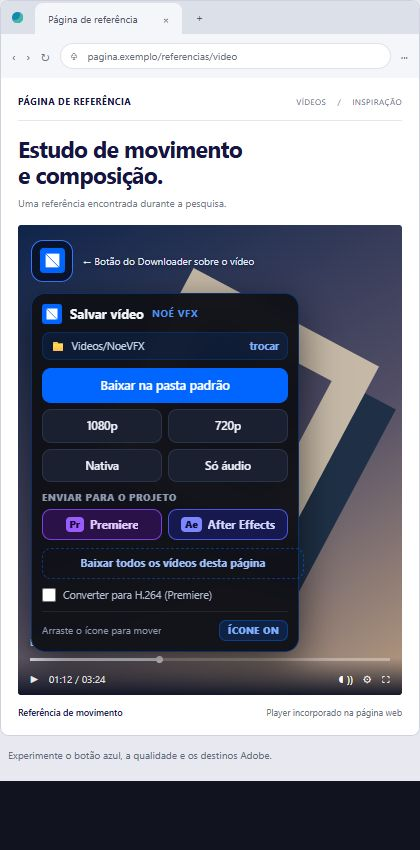
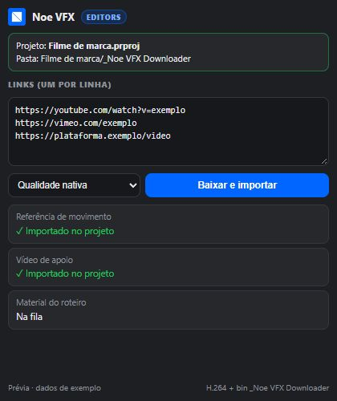
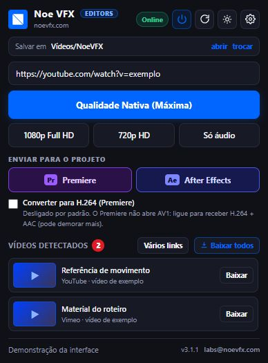
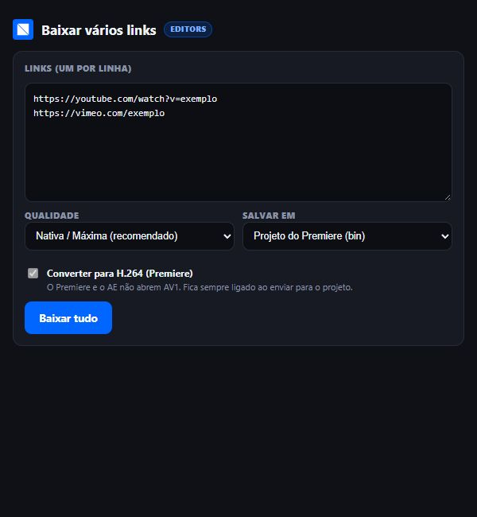

# Noe VFX Downloader — do primeiro clique ao projeto

**[Abrir o manual visual](https://noevfx.github.io/noevfx-downloader/instalar.html)** · [Apresentação](https://noevfx.github.io/noevfx-downloader/) · [Downloads](https://github.com/noevfx/noevfx-downloader/releases)

Você pode começar de dois jeitos: **encontrar uma referência no navegador** e enviar ao editor, ou **colar os links recebidos do cliente** no painel Adobe. O resultado é o mesmo: os arquivos na pasta do trabalho e dentro do projeto.

A extensão é para **Chrome, Edge, Brave, Opera, Vivaldi e outros navegadores Chromium**. A integração Adobe está na edição **for Editors**. Este manual descreve a 3.1.1 em validação; confira a versão publicada antes de baixar.

## Escolha o que você quer fazer

1. [Instalar e começar](#1-instalar-e-começar)
2. [Achei um vídeo no navegador](#2-achei-um-vídeo-no-navegador)
3. [Recebi links do cliente ou do roteiro](#3-recebi-links-do-cliente-ou-do-roteiro)
4. [Quero baixar vários vídeos](#4-quero-baixar-vários-vídeos)
5. [Escolher qualidade e compatibilidade](#5-escolher-qualidade-e-compatibilidade)
6. [Configurar a pasta e o botão](#6-configurar-a-pasta-e-o-botão)
7. [Atualizar ou desinstalar](#7-atualizar-ou-desinstalar)
8. [Algo não funcionou](#8-algo-não-funcionou)

## 1. Instalar e começar

**Quer só salvar vídeos numa pasta?** Escolha o pacote **basic**. **Quer enviar ao Premiere/After Effects e importar pelo painel?** Escolha **for Editors**, o pacote sem “basic” no nome. Uma edição substitui a outra.

1. Baixe o ZIP em [Releases](https://github.com/noevfx/noevfx-downloader/releases) e use **Extrair tudo**.
2. Abra o instalador da pasta do seu sistema:

   | Sistema | O que abrir |
   |---|---|
   | Windows | `windows/INSTALAR_NOEVFX.bat` |
   | macOS | `mac/INSTALAR-MAC.command` — botão direito → Abrir na primeira vez |
   | Linux | No terminal, dentro de `linux/`: `bash instalar-noevfx.sh` |

3. Espere o instalador preparar o aplicativo e as ferramentas. Precisa de internet; a instalação padrão é por usuário, sem senha de administrador. Leia os avisos antes de fechar.
4. No navegador, abra a página de extensões: `edge://extensions` no Edge ou `chrome://extensions` no Chrome. Nos demais Chromium, use o gerenciador de extensões.
5. Ligue **Modo do desenvolvedor**, escolha a opção de carregar uma extensão sem pacote e selecione a pasta **extension instalada**. O guia e o Explorer/Finder abertos pelo instalador ajudam a encontrá-la.
6. Abra o popup do Downloader: o selo deve mostrar **Online**. Escolha sua pasta de downloads.

> **A pasta certa faz diferença.** No Windows, use `%LOCALAPPDATA%/NoeVFXDownloader/extension`. Evite a pasta extraída do ZIP: o navegador pode continuar lendo essa cópia enquanto o atualizador modifica a instalação.

**Para usar com Adobe:** na edição for Editors, reinicie o Premiere/After Effects depois de instalar. Abra e salve um projeto. Procure **Janela → Extensões → Noe VFX for Editors** e confira se o painel mostra o projeto. O painel usa CEP; a disponibilidade depende da versão do editor. No macOS, a validação física ainda está pendente.

[Ver a instalação ilustrada →](https://noevfx.github.io/noevfx-downloader/instalar.html)

## 2. Achei um vídeo no navegador

Você está pesquisando uma linguagem, um movimento ou uma referência. Encontrou o vídeo certo?

1. **Passe o mouse sobre o player** e clique no botão azul do Downloader.
2. Em **Enviar para o projeto**, escolha **Premiere** ou **After Effects**.
3. Acompanhe o andamento e confira o arquivo no projeto aberto.

<table><tr><th>Na página web</th><th>No projeto</th></tr><tr><td width="50%"></td><td width="50%">
O arquivo é salvo na pasta do trabalho e importado na pasta/bin <code>_Noe VFX Downloader</code> do projeto.
</td></tr></table>

Interfaces atuais com dados de exemplo. O projeto precisa estar salvo e aberto, com o componente Adobe instalado e ativo.

O envio usa a **qualidade padrão** configurada. Se quiser escolher qualidade e destino no mesmo pedido, use **Vários links** ou o painel Adobe. Os botões 1080p, 720p, Nativa e Só áudio do menu são atalhos para a sua pasta de downloads.

**Prefere abrir pela barra do navegador?** O popup também oferece os destinos Adobe, permite colar outra URL e lista os vídeos detectados na aba.

Você pode arrastar o botão azul para outra posição. Para desligá-lo, use o controle do ícone; o popup continua disponível. Em páginas que carregam o vídeo aos poucos, dê play por um instante e procure novamente.

[Experimente o tutorial visual navegador → projeto →](https://noevfx.github.io/noevfx-downloader/manual.html#pelo-navegador)

## 3. Recebi links do cliente ou do roteiro

Continue no editor. Não precisa abrir e baixar cada endereço separadamente.

1. Abra **Noe VFX for Editors** no Premiere ou After Effects.
2. Confira o nome do projeto e a pasta mostrados no painel.
3. Cole **um link por linha**.
4. Escolha **Qualidade nativa**, **Até 1080p** ou **Até 720p**.
5. Clique em **Baixar e importar** e acompanhe o resultado de cada item.

### Onde o arquivo fica?

O app salva os vídeos na pasta `_Noe VFX Downloader` do trabalho. O painel também os importa na pasta/bin de mesmo nome dentro do projeto.

- Se o projeto está em `Filme/Premiere/corte.prproj`, os vídeos vão para `Filme/_Noe VFX Downloader`.
- Se o projeto está solto em `Filme/corte.prproj`, o destino também é `Filme/_Noe VFX Downloader`.
- No After Effects, vale o mesmo princípio para a pasta do trabalho.

Se não identificar o projeto, o app avisa. Se o download terminar e a importação falhar, confira a mensagem e a pasta do trabalho: o arquivo pode continuar disponível para importação manual.

[Ver os dois editores no guia visual →](https://noevfx.github.io/noevfx-downloader/manual.html#passos)

## 4. Quero baixar vários vídeos

| O que você tem | O caminho mais direto |
|---|---|
| Vários vídeos detectados na mesma página | **Baixar todos os vídeos desta página** no menu integrado ao player. Salva na pasta de downloads. |
| Uma lista de links de páginas diferentes | **Vários links** no popup: cole a lista, escolha qualidade e destino e use **Baixar tudo**. |
| Uma lista e o projeto já aberto no editor | Cole os links no painel Adobe e use **Baixar e importar**. |

Em **Vários links**, o menu **Salvar em** oferece pasta padrão, outra pasta e, na edição for Editors, projeto do Premiere ou After Effects. O envio ao projeto exige o componente Adobe instalado e ativo.

Links repetidos e textos que não forem endereços são filtrados. Pedir o mesmo vídeo enquanto ele já baixa não deve criar outro download. A fila mostra o resultado dos itens; não é uma biblioteca permanente de tudo que você já baixou.

## 5. Escolher qualidade e compatibilidade

| Opção | Resultado |
|---|---|
| **Nativa / Máxima** | A melhor resolução disponível para aquele download. |
| **1080p** | Até 1080p; não amplia um vídeo menor. |
| **720p** | Até 720p; costuma gerar arquivo menor. |
| **Só áudio** | Salva o som em M4A no navegador. Não aparece no painel Adobe. |

**Precisa abrir no editor?** O envio ao projeto já pede compatibilidade H.264. Nos downloads comuns do navegador, você pode ligar **Converter para H.264** quando precisar.

**Se a plataforma já oferece H.264 na resolução escolhida, o app prefere esse formato e preserva o vídeo.** Se vídeo e áudio vierem separados, apenas junta os dois. Se só o áudio precisar virar AAC, converte só o áudio. Se o vídeo só estiver disponível em AV1/VP9, converte depois de baixar.

MP4 é o recipiente, não o codec: um `.mp4` também pode conter AV1. A compatibilidade com seu editor depende do conteúdo, da versão do programa e do hardware.

<b>Como a CPU e a GPU entram nesse processo?</b>

Na 3.1.1, no Windows, o app identifica a GPU indicada para alto desempenho e testa se consegue usá-la. O progresso mostra o modelo. Para vídeos longos, compara uma pequena amostra na GPU e na CPU; se a CPU ganhar, usa o processador. Se a GPU falhar durante a conversão, tenta pela CPU.

A identificação e o vencedor ficam guardados durante a sessão. A comparação ainda não é separada por resolução, então não garante a escolha mais rápida em todo vídeo. A seleção entre placas da mesma marca foi simulada; duas Intel reais ainda precisam de validação. Fora do Windows permanece o caminho anterior de seleção por codificador disponível.

[Entenda os formatos e veja exemplos →](https://noevfx.github.io/noevfx-downloader/formatos.html)

## 6. Configurar a pasta e o botão

Abra a **engrenagem** no popup.

- **Pasta padrão:** escolha onde salvar downloads comuns. Sem escolha anterior, o app usa `NoeVFX` dentro da pasta de vídeos do usuário. O envio ao projeto segue o destino do trabalho, não essa pasta.
- **Comportamento do botão:** “Perguntar antes de salvar” abre o menu; “Salvar direto” usa a qualidade padrão. Para escolher um editor no menu, mantenha a opção de perguntar.
- **Ícone visível:** você pode desligar o botão sobre os vídeos e continuar usando o popup.
- **Cookies:** para conteúdo que exige login, entre na plataforma no navegador. Essa opção permite usar sua sessão, sem contornar restrições de acesso.
- **Subpasta por site:** organiza downloads comuns por domínio.

Clique em **Salvar configurações** após alterar os campos. Nas mesmas configurações, os indicadores de ferramentas ajudam a verificar se o app local está pronto.

[Ver as configurações ilustradas →](https://noevfx.github.io/noevfx-downloader/configuracoes.html)

## 7. Atualizar ou desinstalar

### Vou migrar do repositório antigo

Recebeu o pacote do novo `noevfx-downloader`? **Rode o instalador desse pacote e recarregue a extensão instalada.** Não dependa do botão das versões antigas para atravessar a mudança de endereço.

Normalmente é possível instalar por cima e manter as preferências. Se desinstalar primeiro, anote pasta e configurações: os arquivos de configuração também serão removidos.

### Já estou no novo fluxo e quero atualizar

1. Espere os downloads ativos terminarem.
2. Abra o popup. Se houver uma versão publicada nova, use **Atualizar agora**. Para conferir, clique na versão ou em **Verificar atualizações** nas configurações.
3. Depois, dê **F5** nas páginas com vídeo. Em outros perfis do navegador, use **Recarregar extensão** quando solicitado.

O botão depende de uma **release publicada**, não apenas de código novo no GitHub. Na 3.1.1, se o painel Adobe faltar, o app pode tentar instalá-lo a partir da release da mesma versão; o popup informa as etapas ou a falha. Se não conseguir, rode o instalador for Editors e reinicie o editor.

### Quero desinstalar

1. Feche os programas Adobe.
2. Rode `DESINSTALAR_NOEVFX.bat` no Windows ou `bash desinstalar-noevfx.sh` no macOS/Linux.
3. Leia os avisos: o desinstalador tenta remover aplicativo, inicialização automática e painel Adobe do usuário atual.
4. **Remova a extensão em cada navegador e perfil** onde a instalou.

Os vídeos baixados são preservados. Arquivos em uso podem impedir a remoção completa; confira os avisos antes de considerar concluído.

## 8. Algo não funcionou

| O que aconteceu | Primeiro passo |
|---|---|
| **Offline** | Rode o instalador novamente para iniciar o app e conferir as ferramentas. |
| O vídeo não aparece | Dê play por um instante e atualize a busca no popup. |
| Atualizei, mas parece antigo | Recarregue a extensão em cada perfil, dê F5 na página e confira se carregou a pasta instalada. |
| O painel Adobe não aparece | Confira a edição for Editors, reinicie o editor e veja os avisos da instalação. A versão do editor precisa suportar CEP. |
| O projeto não foi reconhecido | Abra e salve o projeto, deixe o correto ativo e confira a mensagem do painel. |
| Baixou, mas não importou | Confira a mensagem de importação e procure o arquivo na pasta do trabalho. |
| Veio sem áudio | Confira FFmpeg nas configurações; ele une vídeo e áudio de muitas plataformas. |
| O editor não abre o arquivo | Ligue a compatibilidade H.264 e baixe novamente. Um arquivo antigo não é convertido sozinho. |

**Ainda precisa de ajuda?** Use **Configurações → Copiar diagnóstico** e informe o que fez e a mensagem recebida. Revise o material antes de enviar: não publique cookies, tokens, configurações pessoais ou links privados de clientes.

[Mais soluções](https://noevfx.github.io/noevfx-downloader/ajuda.html) · [Abrir issue](https://github.com/noevfx/noevfx-downloader/issues) · [labs@noevfx.com](mailto:labs@noevfx.com)

<b>Plataformas, privacidade e limites</b>

A disponibilidade varia por site, vídeo e sessão. Há testes de players e feeds simulados, além de validações reais descritas no histórico; isso não garante acesso a todo conteúdo. macOS/Linux e alguns cenários de hardware ainda precisam de validação física.

Conteúdo protegido por DRM não é suportado. Conteúdo privado exige acesso válido. Cancelar uma live pode não preservar um arquivo parcial utilizável. Use apenas vídeos que você tenha autorização para salvar e usar.

Não há conta nem telemetria da Noé VFX. Os pedidos vão ao app local e aos serviços necessários para baixar ou atualizar. [Privacidade](../PRIVACY.md) · [Termos](../TERMS.md) · [Licença](../LICENSE).

Manual da versão 3.1.1 · renderizações das interfaces atuais com dados de exemplo · [noevfx.com](https://noevfx.com)
