# Noe VFX Downloader — Manual de uso (com telas)

Salva os vídeos que **você já consegue assistir** no navegador, na qualidade que o player oferece.
Funciona no **Windows, macOS e Linux**, em **Chrome, Edge, Brave, Opera e Vivaldi**. Roda tudo no seu
computador: sem conta, sem anúncios e sem telemetria.

> Este manual é para quem vai **usar**. Quem quer só instalar rápido: [README](../README.md).

---

## Índice

1. [Como funciona](#1-como-funciona)
2. [Instalar](#2-instalar)
3. [Primeiro uso: configurações](#3-primeiro-uso-configurações)
4. [Baixar um vídeo](#4-baixar-um-vídeo) (ícone no vídeo · popup · botão direito · YouTube)
   - [Plataformas testadas](#plataformas-testadas)
5. [Qualidades](#5-qualidades)
6. [Baixar vários, cancelar e repetidos](#6-baixar-vários-cancelar-e-repetidos)
7. [Cursos, áreas de membros e lives gravadas](#7-cursos-áreas-de-membros-e-lives-gravadas)
8. [Algo deu errado? (perguntas comuns)](#8-algo-deu-errado-perguntas-comuns)
9. [Atualizar e desinstalar](#9-atualizar-e-desinstalar)
10. [Privacidade e segurança](#10-privacidade-e-segurança)

---

## 1. Como funciona

São **duas peças** que conversam entre si, as duas no seu computador:

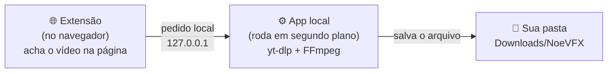

- A **extensão** mostra o ícone azul sobre os vídeos e lista tudo que a página carrega.
- O **app local** é quem baixa de verdade. O instalador liga ele sozinho e ele **inicia junto com o computador**.
- Nada sai do seu computador, a não ser o próprio download vindo do site do vídeo.

---

## 2. Instalar

O instalador faz **tudo sozinho** (Python, yt-dlp, FFmpeg e Deno), **sem senha de administrador** e sem
nada instalado antes. Leva de 1 a 5 minutos e precisa de internet.

O arquivo se chama **`noevfx-downloader-<versão>.zip`** (por exemplo `noevfx-downloader-3.0.14.zip`): a versão
vai no nome e também no `VERSION.txt` dentro do pacote, para você saber sempre qual é.

| Sistema | Como |
|---|---|
| **Windows** | Extraia o ZIP e dê duplo clique em `windows\INSTALAR_NOEVFX.bat` |
| **macOS** | Extraia o ZIP, abra `mac\`, botão direito em `INSTALAR-MAC.command` → **Abrir** (só na 1ª vez) |
| **Linux** | No terminal, dentro de `linux/`: `bash instalar-noevfx.sh` |

> **Já tinha uma versão instalada?** Rode o instalador da versão nova **por cima**. Ele encerra o servidor
> antigo (mesmo um iniciado à mão), troca os arquivos e liga o novo; suas configurações são mantidas.
> Só considera pronto quando o servidor responde **já na versão nova**; se não, ele avisa.

### Último passo: colocar a extensão no navegador

No final o instalador abre **duas janelas**:

- o **guia** (no navegador), com os passos e os botões de copiar;
- o **Explorer** (Windows) / **Finder** (Mac) já na pasta do programa, com a pasta **`extension` selecionada**.

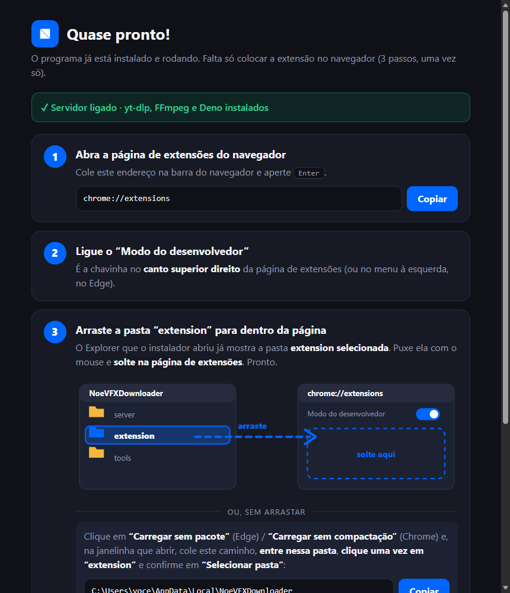

Faça isso **uma vez só**:

1. Abra `chrome://extensions` (ou `edge://extensions`): o botão **Copiar** do guia ajuda.
2. Ligue o **Modo do desenvolvedor** (chavinha no canto superior direito).
3. **Arraste a pasta `extension`** (a que está selecionada no Explorer/Finder) e **solte na página de extensões**. Pronto.

**Se preferir não arrastar:** clique em **Carregar sem pacote** (Edge) / **Carregar sem compactação** (Chrome) e, na
janelinha, cole o caminho que o guia mostra (é a pasta **acima**: `NoeVFXDownloader`), **entre nela**, **clique uma vez
em `extension`** e confirme em **Selecionar pasta**.

> ⚠️ **Não cole o caminho da própria `extension`.** O seletor abriria *dentro* dela, onde não há nada para
> escolher e o botão não funciona. Sempre selecione a pasta `extension` a partir da pasta de cima.

> **Importante:** use sempre a pasta **instalada** (a do Explorer/Finder que o instalador abriu), nunca a pasta
> extraída do ZIP. Se você apagar a pasta do ZIP, nada quebra; se carregar dela e depois apagar, a extensão some.

> **Dica:** o navegador pode avisar sobre "extensões do modo desenvolvedor" ao abrir. Clique em **Manter**.

---
## 3. Primeiro uso: configurações

Clique no ícone da extensão e na **engrenagem** ⚙️. A tela de configurações tem 5 blocos:

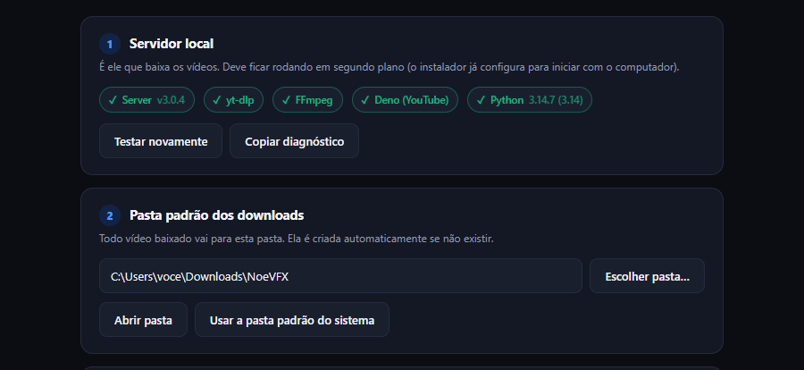

**1 · Servidor local** — mostra se tudo está funcionando (✓ verde = ok): o app, o **yt-dlp**, o **FFmpeg**,
o **Deno** (necessário para o YouTube) e o Python. Se algo falhar, rode o instalador de novo.
O botão **Copiar diagnóstico** gera um texto curto para você colar numa conversa quando precisar de ajuda.

**2 · Pasta padrão** — onde os vídeos serão salvos. Clique em **Escolher pasta…** (abre a janela normal do
sistema). **Abrir pasta** abre ela no Explorer/Finder.

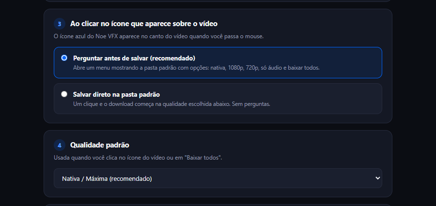

**3 · Ao clicar no ícone sobre o vídeo**
- *Perguntar antes de salvar* (recomendado): abre um menuzinho com as qualidades.
- *Salvar direto*: um clique e o download começa na qualidade padrão.

**4 · Qualidade padrão** — a que vale para o clique direto e para o "Baixar todos".

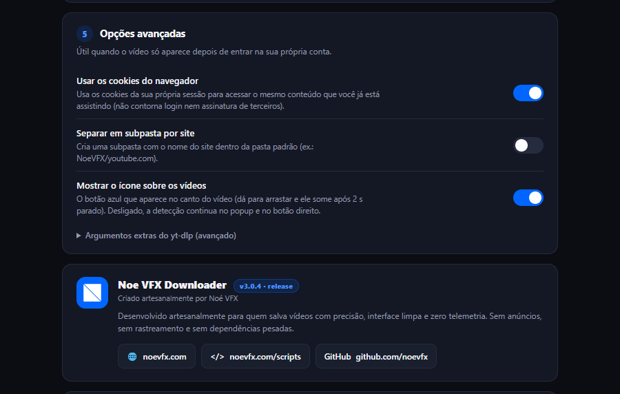

**5 · Opções avançadas**
- *Usar os cookies do navegador*: baixa o que exige login (veja a [seção 7](#7-cursos-áreas-de-membros-e-lives-gravadas)).
- *Separar em subpasta por site*: `NoeVFX/youtube.com`, `NoeVFX/g1.globo.com`…
- *Mostrar o ícone sobre os vídeos*: liga/desliga o ícone azul (a detecção continua no popup e no botão direito).
- *Argumentos extras do yt-dlp*: só para quem sabe; aceita uma lista de opções seguras
  (por exemplo `--extractor-args youtube:player_client=web`).

Não esqueça de clicar em **Salvar configurações**.

---

## 4. Baixar um vídeo

Há **quatro jeitos**. Use o que for mais cômodo.

### A) Pelo ícone azul sobre o vídeo (o mais rápido)

1. Abra a página e **passe o mouse sobre o vídeo**: aparece o ícone azul no canto.

   

   Você pode **arrastar** o ícone para onde preferir (ele lembra a posição por site). Ele some sozinho
   depois de 2 segundos com o mouse parado.

2. **Clique no ícone**: abre o painel com a pasta de destino e as qualidades.

   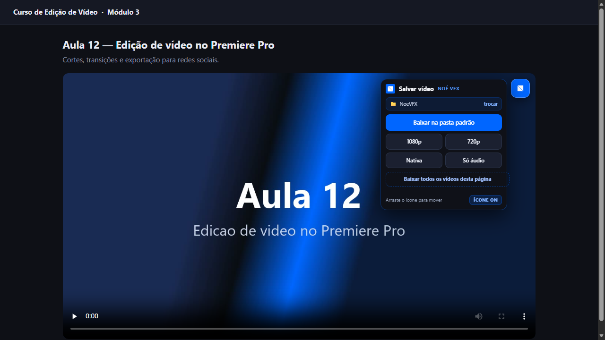

3. Escolha uma opção. O botão grande usa a qualidade padrão; **1080p**, **720p**, **Nativa** (a melhor
   possível) ou **Só áudio**. **Baixar todos os vídeos desta página** enfileira tudo que foi detectado.
   (Para fechar o painel: clique fora dele ou aperte **Esc**.)

4. Acompanhe o progresso no aviso embaixo do vídeo:

   

5. Quando terminar, o aviso diz onde foi salvo:

   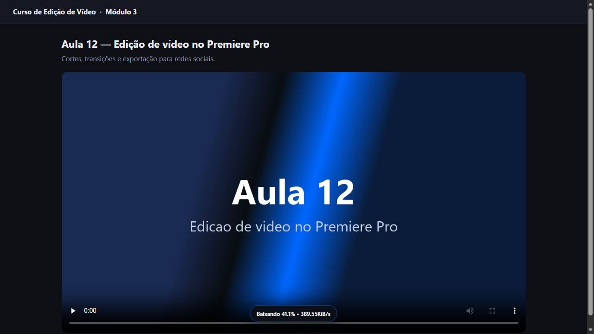

### B) Pelo popup da extensão

Clique no ícone da extensão na barra do navegador. O número vermelho no ícone mostra **quantos vídeos
foram detectados** na aba.

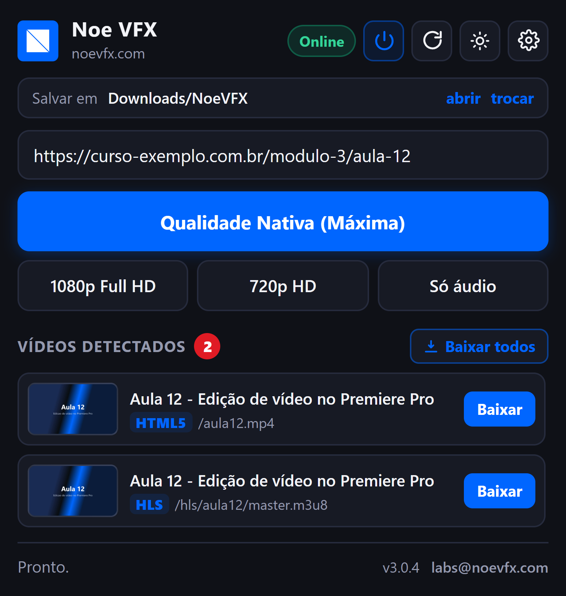

- **Salvar em** — a pasta de destino (**abrir** mostra a pasta; **trocar** vai às configurações).
- O campo de endereço vem preenchido com a página atual: dá para **colar o link de outra página**.
- Os botões de qualidade baixam a página/URL do campo.
- **Vídeos detectados** — cada linha tem miniatura, título, tipo (HLS, MP4, HTML5, Embed…) e o botão
  **Baixar** daquele vídeo específico.
- Os botões do topo: ⏻ liga/desliga o ícone sobre os vídeos, ↻ procura de novo, ☀ troca o tema, ⚙ configurações.

Durante o download aparecem a **barra de progresso** e o botão **Cancelar**:

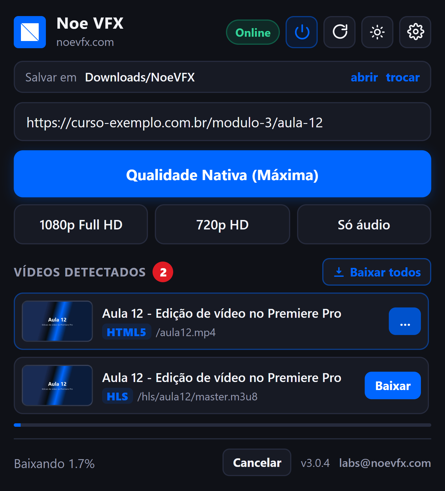

Tem também **tema claro** (botão ☀):

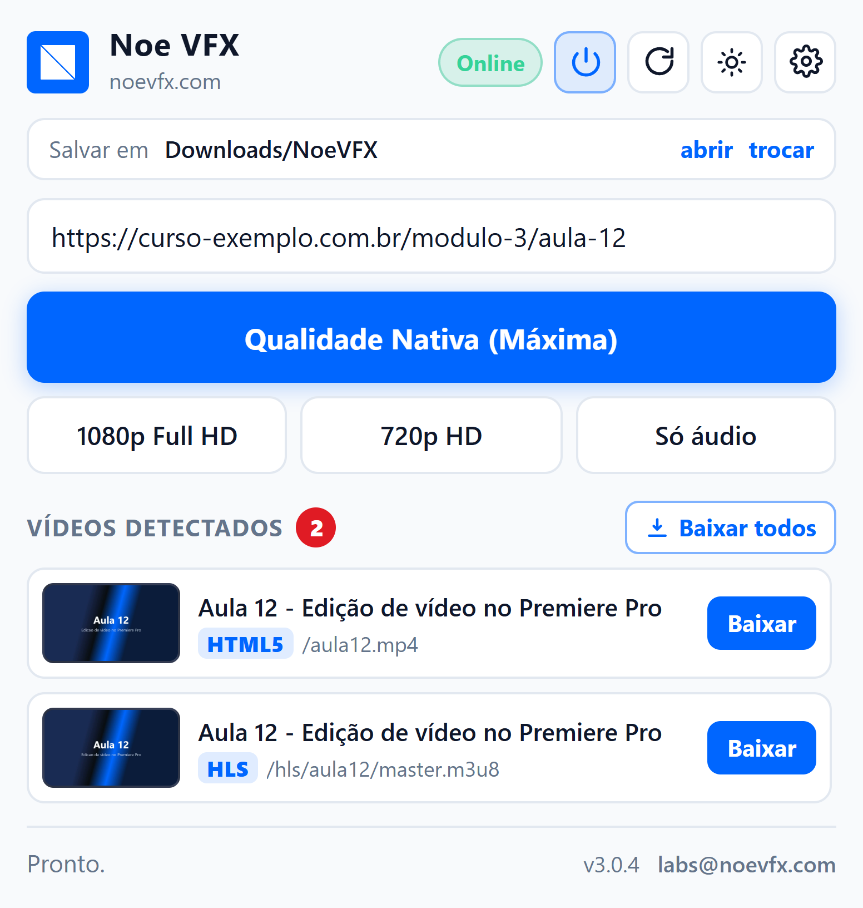

### C) Pelo botão direito do mouse

Clique com o botão direito numa página, vídeo ou link:

- **Baixar vídeo na qualidade nativa**
- **Baixar todos os vídeos desta página**
- **Ligar / desligar o ícone** sobre os vídeos
- **Abrir pasta de downloads** e **Configurações**

### D) Botão "Baixar" no YouTube

Na página de um vídeo do YouTube, aparece um botão **Baixar** junto aos botões de curtir/compartilhar,
com as opções de qualidade. (O YouTube precisa do **Deno**, que o instalador já coloca.)

---

## Plataformas testadas

| Plataforma | O que funciona |
|---|---|
| **YouTube** | botão Baixar no player e item no popup, na melhor qualidade, com áudio |
| **Instagram** | posts e reels; **carrossel: baixa todos os vídeos** (fotos ignoradas); cada vídeo com a própria miniatura |
| **TikTok** | um item por vídeo, com miniatura e nome certos; a lista se atualiza ao rolar o feed |
| **Facebook** | vídeo público baixa pelo link do vídeo/Reel; **no feed ainda não está confirmado** (em ajuste) |
| **X (Twitter)** | um item por tweet com vídeo (testado no feed real); baixa **todos os vídeos do tweet** |
| **Pinterest** | um item por pin, com o nome do pin; **pin com vários vídeos baixa todos** |
| **Vimeo** | vídeos públicos e embutidos em outras páginas |
| **G1 / Globoplay** | o vídeo da matéria (sem confundir com os "veja também"); transmissão ao vivo grava a partir do HLS |
| **Sites comuns** | players com MP4, HLS (.m3u8) e DASH; players embutidos (iframe) de cursos |

**O que não baixa:** vídeo protegido por DRM (Netflix, Disney+ e vídeos Vimeo/Globo marcados como protegidos), conteúdo privado sem login e transmissão ao vivo cancelada no meio (perde o parcial). Para conteúdo que exige login, entre na sua conta no navegador e deixe os cookies ligados nas Configurações.

**Ainda em ajuste:** o feed do Facebook (o X já foi confirmado no uso real). Se algum item vier sem miniatura ou com o arquivo errado, mande o print e o link do post.

## 5. Qualidades

| Opção | O que baixa |
|---|---|
| **Nativa / Máxima** | A melhor qualidade que o vídeo tiver (vídeo + áudio unidos em `.mp4`) |
| **1080p Full HD** | Até 1080p |
| **720p HD** | Até 720p (arquivo menor) |
| **Só áudio** | Apenas o som, em `.m4a` |

Os arquivos têm o nome `Título do vídeo [id].mp4` e ficam na sua pasta padrão.

---

## 6. Baixar vários, cancelar e repetidos

- **Baixar todos** enfileira tudo que a página tem; **3 downloads rodam ao mesmo tempo**, o resto espera a vez.
- **Cancelar** (no popup) interrompe o download em andamento.
- Pedir **o mesmo vídeo duas vezes** enquanto ele baixa não duplica: o app avisa
  *"Este vídeo já está sendo baixado"*.

---

## 7. Cursos, áreas de membros e lives gravadas

- **Conteúdo que pede login** (curso, assinatura): faça o login normalmente no navegador, abra o vídeo e
  baixe. Com **Usar os cookies do navegador** ligado (padrão), o app usa a **sua** sessão para acessar o
  mesmo que você já está vendo. Ele **não** contorna login, assinatura, DRM nem bloqueio de região.
- **Player dentro de um quadro (iframe)** — comum em plataformas de curso: a extensão detecta o stream
  do player e baixa usando o endereço certo do quadro. Se o vídeo não aparecer na lista, **dê play por
  1 segundo** e aperte ↻ no popup.
- **Live gravada**: costuma funcionar. Se a live acabou de terminar, o site às vezes ainda está
  "processando" a gravação — o app avisa em português; tente de novo mais tarde.

---

## 8. Algo deu errado? (perguntas comuns)

| O que aparece | O que fazer |
|---|---|
| **"Servidor local offline — rode o instalador"** | O app não está rodando. Rode o instalador de novo (é seguro, só baixa o que faltar). Ele também liga o app. |
| 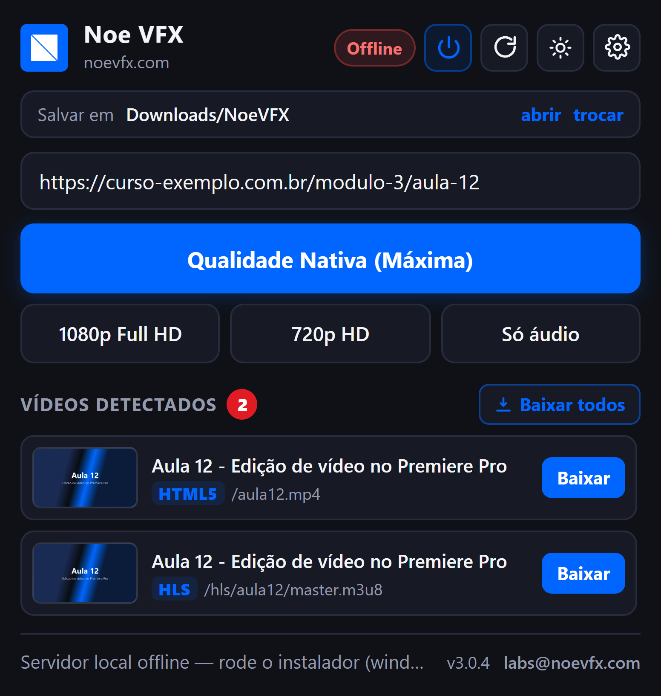 | Assim o popup fica quando o app está desligado (selo **Offline**). |
| **"O app local recusou esta extensão"** | A extensão foi carregada de outra pasta/cópia. Remova e carregue a pasta **instalada** (veja a seção 2). |
| **"App local desatualizado"** | Rode o instalador do ZIP novo; depois **Recarregar** a extensão. |
| **O vídeo veio sem áudio** | Quase sempre é o **FFmpeg**. Veja nas Configurações se o selo FFmpeg está verde; se não, rode o instalador. (Desde a v3.0.1 o app refaz sozinho em formato único com áudio.) |
| **A extensão sumiu / ficou cinza** | Você apagou a pasta de onde carregou. Carregue de novo a pasta **instalada**. |
| **YouTube: "confirme que você não é um robô"** | Entre na sua conta do YouTube no navegador e deixe os **cookies ligados** nas configurações. |
| **O vídeo não aparece na lista** | Dê play no vídeo por um instante e aperte ↻. Em sites com vários vídeos, passe o mouse sobre o certo. |
| **"Este endereço não é suportado direto"** | Dê play no vídeo e use o **ícone sobre o player** (em vez de colar o link da página). |

Não achou? Em **Configurações → Copiar diagnóstico** e cole na conversa com quem te passou o app: o texto
mostra versões, o que está instalado e os últimos downloads (sem links completos e sem seu nome de usuário).

---

## 9. Atualizar e desinstalar

**Atualizar pelo botão (a partir da 3.0.14):** a extensão roda em modo desenvolvedor e o navegador não a atualiza sozinho,
então o próprio app local faz isso. Ao abrir o popup ele confere a última release no GitHub; se houver versão nova, aparece uma
faixa azul com **Atualizar agora**. Para conferir na hora, clique na **versão no rodapé do popup** ou em **Verificar atualizações**
nas Configurações. Ao confirmar, o app baixa o pacote, **confere o SHA-256**, guarda uma cópia da versão atual em
`_backups` (na pasta instalada), troca os arquivos, reinicia o servidor e a extensão se recarrega. Se houver download em andamento,
ele pede para esperar terminar.

**Atualizar pelo instalador (sempre funciona, e é o caminho das versões antes da 3.0.14):** rode o instalador do ZIP novo (ele
detecta a instalação, troca os arquivos e reinicia o app) e, em `chrome://extensions`, clique em **Recarregar** no cartão da
extensão. Suas configurações e a pasta escolhida são mantidas. O **yt-dlp se atualiza sozinho** uma vez por dia (os sites mudam
toda semana).

**Desinstalar:** rode `DESINSTALAR_NOEVFX.bat` (Windows) ou `bash desinstalar-noevfx.sh` (Mac/Linux) e,
no navegador, **Remover** a extensão. Os vídeos baixados **não** são apagados.

---

## 10. Privacidade e segurança

- **Zero telemetria**: nenhum dado é enviado para a Noé VFX. Os únicos acessos à internet são o download
  do próprio vídeo (feito pelo yt-dlp) e a instalação/atualização das ferramentas (GitHub).
- O app local só aceita pedidos **da sua extensão**, vindos do próprio computador. Outros sites e outras
  extensões não conseguem mandar ele baixar nada.
- Os cookies da sua sessão vão **só** para o app local, ficam num arquivo temporário durante o download e
  são apagados em seguida.
- Use apenas com conteúdo que você tem o direito de salvar. Veja [TERMS.md](../TERMS.md) e
  [PRIVACY.md](../PRIVACY.md).

---

As telas deste manual são geradas automaticamente com o app real: `node tools/capturar-telas.js`.
Versão do manual: 3.0.14 · [noevfx.com](https://noevfx.com) · labs@noevfx.com
